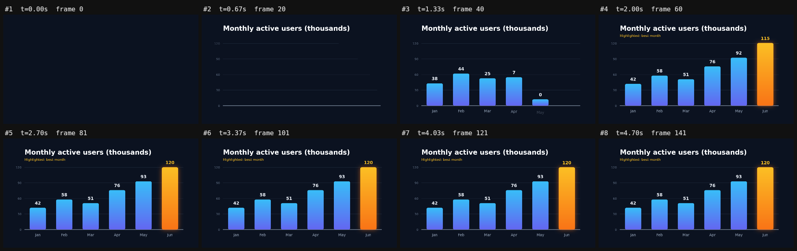
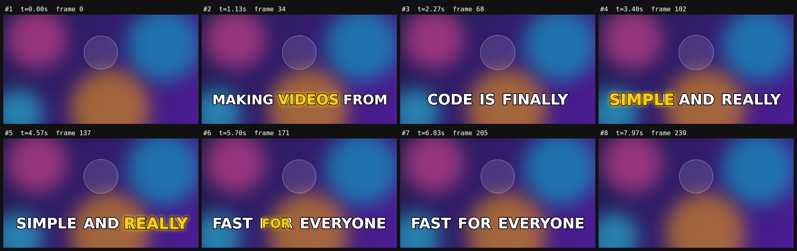

# Frameflow

**Video as code, made simple.** Write motion graphics in TypeScript or plain JSON, with every time in **seconds**. Frameflow renders to MP4 **without a browser**, 5× faster than Remotion on [our benchmark](docs/04-benchmark.md), and it's built so coding agents (Claude Code, Codex, Cursor) can write *and check* videos on their own.

```ts
import { video, text, circle, stagger } from 'frameflow';

export default video({ width: 1280, height: 720, background: '#0f172a' }, [
  text('Hello, Frameflow', { y: 300, size: 96, weight: 'bold', enter: 'fadeUp', exit: 'fade' }),
  stagger(['#f43f5e', '#22c55e', '#3b82f6'].map((fill, i) =>
    circle({ x: 440 + i * 200, y: 520, r: 40, fill, enter: 'pop' })), { start: 0.8, step: 0.15 }),
]);
```

```bash
frameflow preview scene.ts          # live preview in the browser, hot reload
frameflow check scene.ts            # validate: exact paths + "did you mean" fixes
frameflow storyboard scene.ts       # one PNG of the whole timeline (great for AI review)
frameflow render scene.ts out.mp4   # parallel render → MP4 / WebM / MOV
```


## Why another one? This is a Remotion learning project

We studied [Remotion](https://github.com/remotion-dev/remotion) (63k ★), the leading "video in React" framework, collected its users' main complaints, and rebuilt the same core job with a different trade-off. Full write-ups:

| Doc | What's in it |
|---|---|
| [01 · Remotion deep dive](docs/01-remotion-deep-dive.md) | How Remotion works, its API, license, and pain points with linked evidence |
| [02 · Market research](docs/02-market-research.md) | Remotion, HyperFrames, Motion Canvas, Manim, Revideo, Editly, hosted APIs, pricing, unmet needs |
| [03 · Frameflow design](docs/03-frameflow-design.md) | Complaint → change table, API, architecture, agent workflow, trade-offs, roadmap |
| [04 · Benchmark](docs/04-benchmark.md) | Same video in both tools: speed, install size, lines of code, visual parity |

### Same video, both tools ([details](docs/04-benchmark.md))

| | Remotion 4.0.534 | Frameflow |
|---|---|---|
| Render 6s @ 720p (median of 3) | 13.15 s | **2.65 s (5.0× faster)** |
| Render 6s @ 1080p | 17.28 s | **4.82 s (3.6× faster)** |
| Production install | 342 MB + 236 MB Chrome | **76 MB** |
| Runtime packages | 254 | **25** |
| Scene code | 125 lines, 3 files | **16 lines, 1 file** |
| Visual parity | — | **42.3 dB PSNR** (visually identical) |
| License | Paid for companies of 4+ people | **MIT** |

### What's easier

| Remotion | Frameflow |
|---|---|
| `interpolate(frame, [0.2*fps, 0.8*fps], [0, 1], {extrapolateLeft:'clamp', extrapolateRight:'clamp'})` | `opacity: { from: 0, to: 1, at: 0.2, dur: 0.6 }` |
| `spring({ frame: frame - 45, fps, config: { damping: 12 } })` inside a component | `enter: 'pop'` |
| `<Sequence from={45}>` | `start: 1.5` |
| `delayRender()` / `continueRender()` + 30 s timeouts | nothing: assets preload automatically |
| React + webpack + headless Chrome | plain data, Skia canvas, FFmpeg |
| (no equivalent) | `check` with "did you mean", `storyboard` PNG, JSON Schema |

## Quick start

```bash
git clone https://github.com/ku2055/frameflow && cd frameflow
npm install            # builds automatically (prepare script)
node dist/cli.js preview examples/product-launch.ts
node dist/cli.js render examples/product-launch.ts out/launch.mp4
npm test               # 37 tests
```

Use it in your own project: `npm install github:ku2055/frameflow`, then `npx frameflow init my-video`.

## The model

A video is a tree of nodes. Every node accepts `start`, `duration`, `x`, `y`, `anchor`, `opacity`, `scale`, `rotate`, `blur`, `shadow`, `enter` and `exit`.

| Node | Props |
|---|---|
| `text(str, {...})` | `size`, `color`, `font`, `weight`, `align`, `maxWidth` (wraps), `lineHeight`, `letterSpacing`, `stroke` |
| `counter({ from, to, dur, prefix, suffix, separator, decimals })` | animated numbers ("$12,400") |
| `rect({ w, h, radius, fill, stroke })` | `fill` can be a color or a linear/radial gradient |
| `circle({ r, fill })` | |
| `line({ points, width, color, progress })` | animate `progress` to draw the line on |
| `path({ d, fill, stroke })` | SVG path data |
| `image(src, { w, h, fit, radius })` | local path or URL |
| `group(children, {...})` | transforms and timing apply to children. A group with `x`/`y` acts as a container |

**Any number, length or color can animate:**

```ts
x: 100                                               // constant
x: { from: 0, to: 500, at: 1, dur: 0.8, ease: 'easeOutBack' }   // tween (always clamped)
x: { '0': 0, '1': 500, '2': 500, '3': 0, ease: 'easeInOut' }     // keyframes, keys in seconds
scale: { '0': 1, '0.5': 1.1, '1': 1, loop: true }    // looping keyframes
rotate: { from: 0, to: 360, dur: 2, ease: 'linear', repeat: true } // repeat / yoyo
opacity: ({ t, progress, frame }) => Math.sin(t)     // function (TypeScript only)
```

**Presets** (`enter` / `exit`): `fade` `fadeUp` `fadeDown` `fadeLeft` `fadeRight` `pop` `zoom` `slideUp` `slideDown` `slideLeft` `slideRight` `typewriter` `wipe` `blur`

**Timing helpers:** `sequence(nodes, { gap })` (a negative gap overlaps items) and `stagger(nodes, { step })`. **Eases:** 20 named curves, `spring`, `{ spring: { damping } }`, and `cubic-bezier(...)`. **Utilities:** `random(seed)` and `measureText()`.

**Data-driven videos:** export a function, which may be async: `export default async (props) => video(...)`, then render with `frameflow render scene.ts --props '{"name":"Ada"}'`.

**Audio:** `video({ audio: [{ src: 'music.mp3', start: 0, volume: 0.6, fadeOut: 1 }] })`

## Examples

| Example | Shows |
|---|---|
| [`hello.ts`](examples/hello.ts) | The benchmark video |
| [`product-launch.ts`](examples/product-launch.ts) | 3-scene promo, crossfading `sequence`, gradients, looping pulse |
| [`bar-chart.ts`](examples/bar-chart.ts) | Data-driven chart from `props`, spring bars, `counter` labels |
| [`captions.ts`](examples/captions.ts) | TikTok-style word-highlight captions with `measureText` |
| [`kinetic-type.json`](examples/kinetic-type.json) | **Pure JSON** kinetic typography, no code |
| [`logo-reveal.ts`](examples/logo-reveal.ts) | SVG path logo, draw-on line, glow, blur-in |

| | |
|---|---|
|  |  |

## Built for coding agents

The loop: **write → `check` → `storyboard` (look at it) → `render`.**

- [`AGENTS.md`](AGENTS.md): the whole API on one page, sized to fit in a prompt.
- [`.claude/skills/frameflow`](.claude/skills/frameflow/SKILL.md): a Claude Code skill for making videos in this repo.
- [`schema/scene.schema.json`](schema/scene.schema.json): JSON Schema, generated from the validator so the two never drift.
- `check --json`: machine-readable issues such as `{ "path": "children[0].enter", "message": "Unknown preset \"fadeUpp\". Did you mean \"fadeUp\"? …" }`


## How it was built

This repo was built in one Claude Code session with subagents:

- **Haiku** researched Remotion and the market.
- **Sonnet** built the idiomatic Remotion baseline for the benchmark, then dogfooded Frameflow by writing the examples. Its usability report found **2 bugs and 9 friction points**. Fixes for most shipped (container groups, `counter`, `measureText`, loops, bundle resolution); the rest are on the roadmap.
- **Opus** designed and wrote the engine, ran the benchmarks, and wrote these docs.

## Status and roadmap

v0.1: the core engine, CLI, preview, player and agent tooling work and are tested. **Not yet:** video clips, layout helpers (`row`/`column`), rich-text spans, sequence transitions, serverless chunk rendering. See the [roadmap](docs/03-frameflow-design.md#7-roadmap).

MIT © Frameflow contributors
