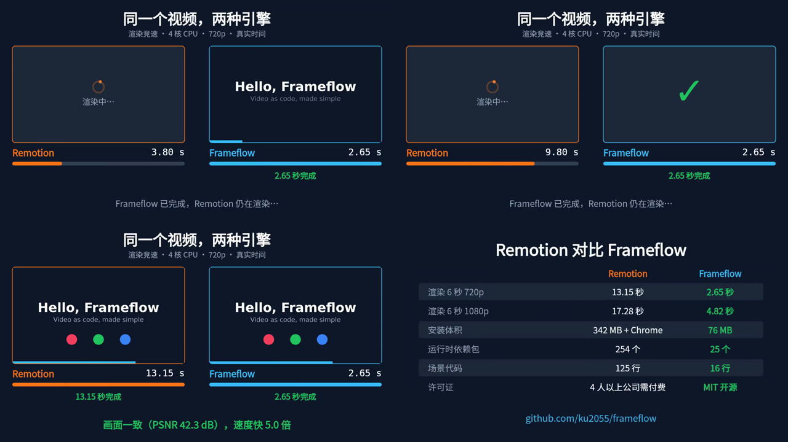
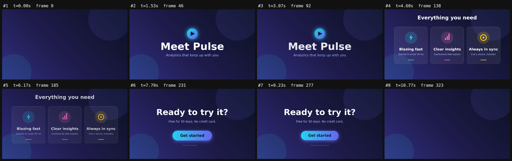
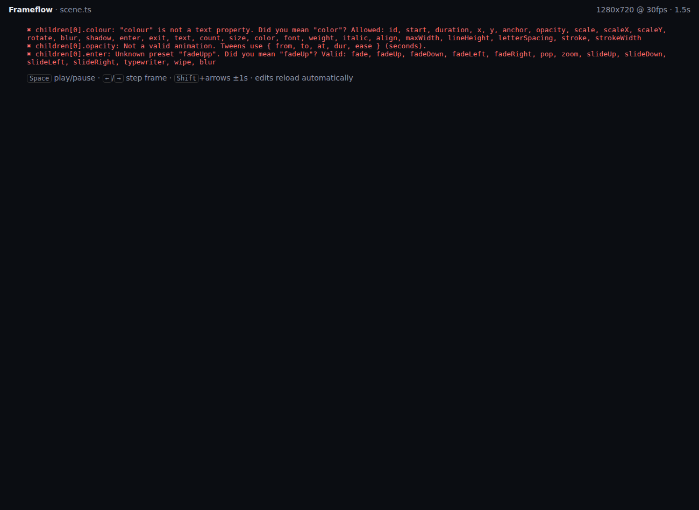

# Frameflow

[English](README.md) · **简体中文**

**用代码做视频，就这么简单。** 用 TypeScript 或纯 JSON 编写动态图形，所有时间都以**秒**为单位。Frameflow **无需浏览器**即可渲染 MP4，在[我们的基准测试](docs/04-benchmark.md)中比 Remotion **快 5 倍**。它专为编程智能体（Claude Code、Codex、Cursor）设计，让 AI 能自己写视频，也能自己检查视频。

```ts
import { video, text, circle, stagger } from 'frameflow';

export default video({ width: 1280, height: 720, background: '#0f172a' }, [
  text('你好，Frameflow', { y: 300, size: 96, weight: 'bold', enter: 'fadeUp', exit: 'fade' }),
  stagger(['#f43f5e', '#22c55e', '#3b82f6'].map((fill, i) =>
    circle({ x: 440 + i * 200, y: 520, r: 40, fill, enter: 'pop' })), { start: 0.8, step: 0.15 }),
]);
```

> 中文文字需要中文字体：在 `video({ font: 'Noto Sans SC', fonts: { 'Noto Sans SC': 'NotoSansSC.ttf' } })` 中注册字体即可，参见 [`examples/comparison.ts`](examples/comparison.ts)。

```bash
frameflow preview scene.ts          # 浏览器实时预览，热更新
frameflow check scene.ts            # 校验场景：给出精确路径和“你是不是想写…”的修改建议
frameflow storyboard scene.ts       # 把整条时间线拼成一张 PNG（方便 AI 审阅）
frameflow render scene.ts out.mp4   # 并行渲染 → MP4 / WebM / MOV
```

## 渲染竞速：同一个视频，Remotion 对比 Frameflow

[](docs/media/comparison.zh.mp4)

两个工具在同一台 4 核机器上渲染同一段 6 秒视频。每个面板显示该工具的真实渲染结果，并按真实时间在渲染完成时出现：**Frameflow 用时 2.65 秒，Remotion 用时 13.15 秒**。随后两段视频并排同步播放，可以看到画面完全一致（PSNR 42.3 dB）。[▶ 观看视频](docs/media/comparison.zh.mp4) · [English version](docs/media/comparison.mp4) · 用 `node scripts/make-comparison.mjs` 重新生成。

| | Remotion 4.0.534 | Frameflow |
|---|---|---|
| 渲染 6 秒视频 @ 720p（3 次取中位数） | 13.15 秒 | **2.65 秒（快 5.0 倍）** |
| 渲染 6 秒视频 @ 1080p | 17.28 秒 | **4.82 秒（快 3.6 倍）** |
| 生产环境安装体积 | 342 MB + 236 MB Chrome | **76 MB** |
| 运行时依赖包 | 254 个 | **25 个** |
| 场景代码 | 125 行，3 个文件 | **16 行，1 个文件** |
| 画面一致性 | — | **PSNR 42.3 dB**（肉眼无差别） |
| 许可证 | 4 人以上的公司需付费 | **MIT 开源** |

测试环境、方法和注意事项见[基准测试文档](docs/04-benchmark.md)（英文）。

## 哪些地方更简单

| Remotion | Frameflow |
|---|---|
| `interpolate(frame, [0.2*fps, 0.8*fps], [0, 1], {extrapolateLeft:'clamp', extrapolateRight:'clamp'})` | `opacity: { from: 0, to: 1, at: 0.2, dur: 0.6 }` |
| 在组件里写 `spring({ frame: frame - 45, fps, config: { damping: 12 } })` | `enter: 'pop'` |
| `<Sequence from={45}>`（以帧为单位） | `start: 1.5`（以秒为单位） |
| `delayRender()` / `continueRender()`，外加 30 秒超时 | 不需要：资源自动预加载 |
| React + webpack + 无头 Chrome | 纯数据 + Skia 画布 + FFmpeg |
| （没有对应功能） | `check` 自动纠错、`storyboard` 分镜图、JSON Schema |

## 为什么要再做一个？这是一个学习 Remotion 的项目

我们研究了 [Remotion](https://github.com/remotion-dev/remotion)（63k ★），即领先的“用 React 做视频”框架，收集了用户的主要痛点，然后换一种取舍重新实现了同样的核心功能。详细文档（英文）：

| 文档 | 内容 |
|---|---|
| [01 · Remotion 深度解析](docs/01-remotion-deep-dive.md) | Remotion 的工作原理、API、许可证，以及有出处的痛点 |
| [02 · 市场调研](docs/02-market-research.md) | Remotion、HyperFrames、Motion Canvas、Manim、Revideo、Editly、托管 API、定价、未被满足的需求 |
| [03 · Frameflow 设计](docs/03-frameflow-design.md) | 痛点 → 改进对照表、API、架构、智能体工作流、取舍、路线图 |
| [04 · 基准测试](docs/04-benchmark.md) | 两个工具做同一个视频：速度、安装体积、代码行数、画面一致性 |

## 快速开始

```bash
git clone https://github.com/ku2055/frameflow && cd frameflow
npm install            # 安装时自动构建（prepare 脚本）
node dist/cli.js preview examples/product-launch.ts
node dist/cli.js render examples/product-launch.ts out/launch.mp4
npm test
```

在自己的项目中使用：`npm install github:ku2055/frameflow`，然后运行 `npx frameflow init my-video`。

## 模型

视频是一棵节点树。每个节点都支持 `start`、`duration`、`x`、`y`、`anchor`、`opacity`、`scale`、`rotate`、`blur`、`shadow`、`enter` 和 `exit`。

| 节点 | 属性 |
|---|---|
| `text(str, {...})` | `size`、`color`、`font`、`weight`、`align`、`maxWidth`（自动换行）、`lineHeight`、`letterSpacing`、`stroke` |
| `counter({ from, to, dur, prefix, suffix, separator, decimals })` | 数字滚动动画（如 “$12,400”） |
| `rect({ w, h, radius, fill, stroke })` | `fill` 可以是颜色，也可以是线性或径向渐变 |
| `circle({ r, fill })` | |
| `line({ points, width, color, progress })` | 给 `progress` 加动画即可“画出”线条 |
| `path({ d, fill, stroke })` | SVG 路径数据 |
| `image(src, { w, h, fit, radius })` | 本地路径或 URL |
| `group(children, {...})` | 变换和时间设置会作用于子节点；设置了 `x`/`y` 的 group 相当于容器 |

**任何数值、长度或颜色都可以做动画：**

```ts
x: 100                                               // 常量
x: { from: 0, to: 500, at: 1, dur: 0.8, ease: 'easeOutBack' }   // 补间（窗口外自动钳制）
x: { '0': 0, '1': 500, '2': 500, '3': 0, ease: 'easeInOut' }     // 关键帧，键为秒
scale: { '0': 1, '0.5': 1.1, '1': 1, loop: true }    // 循环关键帧
rotate: { from: 0, to: 360, dur: 2, ease: 'linear', repeat: true } // 重复 / 往返
opacity: ({ t, progress, frame }) => Math.sin(t)     // 函数（仅 TypeScript）
```

**预设动画**（`enter` / `exit`）：`fade` `fadeUp` `fadeDown` `fadeLeft` `fadeRight` `pop` `zoom` `slideUp` `slideDown` `slideLeft` `slideRight` `typewriter` `wipe` `blur`

**时间工具：** `sequence(nodes, { gap })`（`gap` 为负数时前后重叠）和 `stagger(nodes, { step })`。**缓动：** 20 种命名曲线、`spring`、`{ spring: { damping } }` 以及 `cubic-bezier(...)`。**工具函数：** `random(seed)` 和 `measureText()`。

**数据驱动视频：** 导出一个函数（可以是 async）：`export default async (props) => video(...)`，然后用 `frameflow render scene.ts --props '{"name":"Ada"}'` 渲染。

**音频：** `video({ audio: [{ src: 'music.mp3', start: 0, volume: 0.6, fadeOut: 1 }] })`

## 示例

| 示例 | 演示内容 |
|---|---|
| [`hello.ts`](examples/hello.ts) | 基准测试用的视频 |
| [`comparison.ts`](examples/comparison.ts) | 上面的渲染竞速视频，支持中英文（`--props '{"lang":"zh"}'`），附带中文字体 |
| [`product-launch.ts`](examples/product-launch.ts) | 三幕产品宣传片：交叉淡化的 `sequence`、渐变、循环脉冲 |
| [`bar-chart.ts`](examples/bar-chart.ts) | 由 `props` 驱动的柱状图，弹簧动画柱子，`counter` 数字标签 |
| [`captions.ts`](examples/captions.ts) | 抖音/TikTok 风格的逐词高亮字幕，使用 `measureText` |
| [`kinetic-type.json`](examples/kinetic-type.json) | **纯 JSON** 动态文字排版，无需代码 |
| [`logo-reveal.ts`](examples/logo-reveal.ts) | SVG 路径 Logo、描边动画、发光、模糊淡入 |



## 为编程智能体而生

工作循环：**编写 → `check` → `storyboard`（看一眼）→ `render`。**

- [`AGENTS.md`](AGENTS.md)：一页纸写完整个 API，可以直接放进提示词。
- [`.claude/skills/frameflow`](.claude/skills/frameflow/SKILL.md)：在本仓库中做视频的 Claude Code 技能。
- [`schema/scene.schema.json`](schema/scene.schema.json)：由校验器自动生成的 JSON Schema，两者永远保持一致。
- `check --json`：机器可读的问题列表，例如 `{ "path": "children[0].enter", "message": "Unknown preset \"fadeUpp\". Did you mean \"fadeUp\"? …" }`



## 现状与路线图

v0.1：核心引擎、命令行、预览、播放器和智能体工具链均已可用并有测试覆盖。**尚未支持：** 视频片段、布局工具（`row`/`column`）、富文本、序列转场、无服务器分片渲染。详见[路线图](docs/03-frameflow-design.md#7-roadmap)。

欢迎提交 Issue 和 PR，中文、英文均可。

MIT © Frameflow contributors
