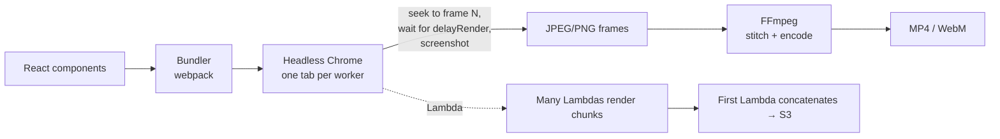

# Learning from Remotion

> Research snapshot: **2026-10-11**. Repository numbers come from the GitHub API on that date. Claims we could not confirm against a primary source are marked *(unverified)*.

## 1. What Remotion is

[Remotion](https://github.com/remotion-dev/remotion) lets you **make videos with React**. A video is a React component, and the current frame number is just a value your component reads. You write the component, preview it in a browser "Studio", and render it to MP4/WebM/GIF locally or in the cloud.

| Fact | Value |
|---|---|
| Repo | [github.com/remotion-dev/remotion](https://github.com/remotion-dev/remotion) |
| Stars / forks | 63,176 / 4,969 |
| Created | 2020-06-23 |
| Latest release | v4.0.534 (2026-10-07), with releases every few days |
| Language | TypeScript monorepo, ~140 packages |
| Main author | Jonny Burger (~32.9k commits; next contributor ~1.2k) |
| License | Source-available "Remotion License", **not** open source (see §5) |

Key packages: `remotion` (core), `@remotion/cli`, `@remotion/renderer`, `@remotion/bundler`, `@remotion/player`, `@remotion/studio`, `@remotion/lambda`, `@remotion/cloudrun`, plus add-ons for captions, transitions, three.js, Skia, Lottie, Rive, fonts, ElevenLabs/Whisper, and AI agents (`skills`, `mcp`, `claude-code-plugin`, `codex-plugin`).

## 2. How it works



1. **Bundle.** Your React project is bundled with webpack ([bundler package](https://github.com/remotion-dev/remotion/tree/main/packages/bundler)).
2. **Open in a browser.** Remotion downloads **Chrome Headless Shell** (about 236 MB in our install) and opens the bundle.
3. **Screenshot each frame.** For each frame it sets the frame number, waits for pending `delayRender()` handles, and captures a JPEG (default) or PNG ([docs](https://www.remotion.dev/docs/render-frames)).
4. **Encode.** FFmpeg stitches the images into a video. Default concurrency is half the CPU threads.
5. **Distributed rendering.** On AWS Lambda, up to 1,000 functions render small chunks in parallel. The first function concatenates them and uploads to S3 ([docs](https://www.remotion.dev/docs/lambda)).

The design rests on one idea: **the browser is the renderer**. Anything that works in Chrome (CSS, SVG, WebGL, canvas, web fonts) works in a video. That is Remotion's biggest strength and the root of most of its costs.

## 3. The core API

| Concept | Remotion | What it does |
|---|---|---|
| Time | `useCurrentFrame()` | The current frame number (an integer) |
| Settings | `useVideoConfig()` | `fps`, `width`, `height`, `durationInFrames` |
| Animation | `interpolate(frame, [0, 30], [0, 1], { extrapolateRight: 'clamp' })` | Map frames to values |
| Physics | `spring({ frame, fps, config })` | Damped spring from 0 to 1 |
| Timing | `<Sequence from={30} durationInFrames={60}>`, `<Series>` | Shift children in time |
| Layout | `<AbsoluteFill>` | A full-size absolutely positioned div |
| Registration | `<Composition id component durationInFrames fps width height>` | Declare a renderable video |
| Assets | `staticFile()`, ``, `<OffthreadVideo>`, `<Audio>` | Load media deterministically |
| Async | `delayRender()` / `continueRender()` (30 s timeout) | Block a frame until data or fonts are ready |
| Data | `calculateMetadata()`, `inputProps` | Data-driven duration and props |

A typical animation looks like this ([full file](../bench/remotion-baseline/src/Promo.tsx)):

```tsx
const frame = useCurrentFrame();
const { fps, durationInFrames } = useVideoConfig();
const clamp = { extrapolateLeft: 'clamp', extrapolateRight: 'clamp' } as const;
const titleIn = interpolate(frame, [0.2 * fps, 0.8 * fps], [0, 1], { ...clamp, easing: Easing.out(Easing.cubic) });
const fadeOut = interpolate(frame, [5.4 * fps, durationInFrames], [1, 0], clamp);
return <div style={{ opacity: titleIn * fadeOut, transform: `translateY(${(1 - titleIn) * 40}px)` }}>Hello</div>;
```

## 4. What Remotion gets right (and we kept)

1. **A video is a pure function of time.** `frame → pixels`, with no hidden state. This one principle makes parallel rendering, scrubbing, and reproducibility possible. *Kept as-is.*
2. **Determinism is a feature.** Seeded `random()`, no wall-clock time, and assets loaded before drawing. *Kept, and enforced: the scene is data, and assets are always preloaded.*
3. **Chunked parallel rendering.** Split frames into ranges, render them independently, concatenate. *Kept, with worker threads on one machine.*
4. **Preview equals render.** The Studio and the final render run the same code. *Kept: the browser player and the Node renderer call the same `drawFrame()`.*
5. **Data-driven videos.** `inputProps` and `calculateMetadata`. *Kept as scene functions `(props) => video(...)`, which can be async.*
6. **Agent tooling.** Skills, `AGENTS.md`, a Claude Code plugin. *Kept, with tooling designed for agents from day one (see the design doc).*

## 5. License and pricing

From [LICENSE.md](https://github.com/remotion-dev/remotion/blob/main/LICENSE.md) and the [license FAQ](https://www.remotion.dev/docs/license/faq):

| Who | Cost |
|---|---|
| Individuals, non-profits, evaluation, companies with **≤ 3 people** | Free |
| Companies with 4+ people: **Creators** (each person writing Remotion code, *including through AI coding tools*) | **$25 per seat per month** |
| **Automators** (server-side rendering, Lambda, Cloud Run, Vercel, Player usage) | **$0.01 per render**, **$100 per month minimum** |
| Enterprise | from **$500 per month** |

You also may not copy or modify Remotion to sell a derivative product. The license says it "will slightly change" in Remotion 5.0 *(new terms unverified)*.

## 6. Pain points, with evidence

| # | Pain point | Evidence |
|---|---|---|
| 1 | **The license confuses people and costs money.** Remotion lists fixing this as a goal of its own 5.0 plan. | Remotion's 5.0 masterplan, [#3310](https://github.com/remotion-dev/remotion/issues/3310), includes "fix flaws in our licensing + raise awareness". [HN 2024](https://news.ycombinator.com/item?id=40656948): "Remotion has a custom license that requires you to have a Company license … Revideo just has the MIT license." [HN 2025](https://news.ycombinator.com/item?id=42813933): "You can't make free-to-use software with Remotion." |
| 2 | **Render speed and CPU scaling.** Screenshotting a full browser per frame is heavy. | [#4664](https://github.com/remotion-dev/remotion/issues/4664): on 48 cores, "increased concurrency does not consistently improve performance and can sometimes make rendering slower". [#4300](https://github.com/remotion-dev/remotion/issues/4300): "Renderer not utilizing CPU cores". |
| 3 | **Timeouts and silent hangs.** | [#214](https://github.com/remotion-dev/remotion/issues/214): "TimeoutError: waiting for function failed: timeout 30000ms exceeded" (20 comments). [#3883](https://github.com/remotion-dev/remotion/issues/3883): chunk timeout with no error. [#11964](https://github.com/remotion-dev/remotion/issues/11964): web render hangs in Safari. |
| 4 | **Correctness under concurrency.** | [#10274](https://github.com/remotion-dev/remotion/issues/10274): `<OffthreadVideo>` "intermittently renders frames from the wrong point", fixed by `--concurrency=1`, and "silently incorrect". |
| 5 | **API footguns in frame math.** | `interpolate()` defaults to `extrapolate: 'extend'`, so values overshoot unless you add `clamp` to every call ([docs](https://www.remotion.dev/docs/interpolate)). Every time is `seconds * fps`. Our baseline repeats the clamp options 4 times in 118 lines. |
| 6 | **Heavy install.** | Our baseline install: **688 MB `node_modules`, 256 packages, 236 MB Chrome** download (measured, see [benchmark](04-benchmark.md)). |
| 7 | **Lambda setup and operations.** | [#1078](https://github.com/remotion-dev/remotion/issues/1078) asks for Terraform/CDK templates. [#3839](https://github.com/remotion-dev/remotion/issues/3839) private buckets. [#5227](https://github.com/remotion-dev/remotion/issues/5227) S3-compatible output. |
| 8 | **Fonts, assets, and audio/video sync.** | [#1394](https://github.com/remotion-dev/remotion/issues/1394) (easier Google Fonts, 23 comments). [#7300](https://github.com/remotion-dev/remotion/issues/7300) (Player A/V desync with mixed fps). [#2900](https://github.com/remotion-dev/remotion/issues/2900) (`extractAudio`, 21 comments). |
| 9 | **React is required.** | A third-party review calls the learning curve "steep for non-developers" ([tooliverse](https://tooliverse.ai/tools/remotion), secondary source). |

**Not found:** a specific public thread about AI agents writing wrong frame math. We infer the risk from item 5 and from Remotion's own need for a 12-skill "best practices" pack. Treat this as a hypothesis, not a measured fact.

## 7. What this means for us

Remotion's problems all come from one decision: **render a whole web browser to make each frame.** That buys unlimited expressiveness (all of CSS and React) and costs speed, install size, timeouts, and a learning curve.

Most "make me a promo/explainer/social clip" videos, which is the job agents are asked to do, need only text, shapes, images, gradients, motion, and audio. For that job, a **purpose-built 2D renderer** with a **data-first, seconds-based API** can be:

- **faster**, with no browser and no screenshot round-trip
- **smaller**, with no Chrome download
- **simpler**, with no React, no frame math, and no `delayRender`
- **safer for agents**, with a typed and validated scene format and a visual self-check
- **freer**, under the MIT license

That is the bet behind Frameflow. See [03-frameflow-design.md](03-frameflow-design.md).
