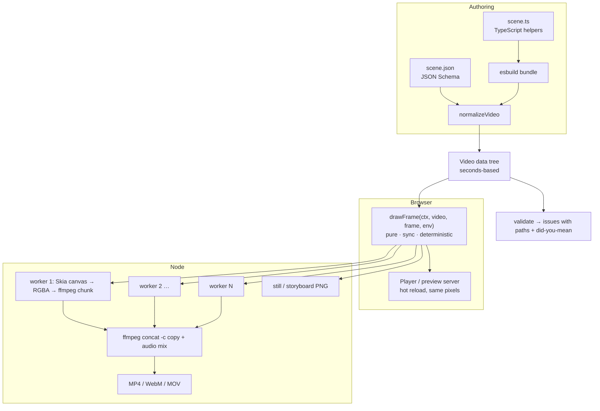

# Frameflow design: same problem, easier solution

Remotion's job is turning code into video. Frameflow does the same job with a different trade-off: **a purpose-built 2D renderer and a data-first API** instead of "React in a headless browser".

## 1. Complaint → change

| Remotion pain point ([evidence](01-remotion-deep-dive.md#6-pain-points-with-evidence)) | Frameflow's answer |
|---|---|
| License cost and confusion | **MIT.** Free for any company, any size, any use, including SaaS and resale. |
| Slow, browser-bound rendering; poor core scaling | **No browser.** Frames are drawn with Skia (`@napi-rs/canvas`) straight into raw RGBA, piped into FFmpeg. Each worker thread draws and encodes its own chunk, so drawing and encoding run in parallel. **5× faster than Remotion** on our [benchmark](04-benchmark.md). |
| `delayRender` timeouts and hangs | **No async during rendering.** All images and fonts load once, *before* the first frame. Drawing a frame is a synchronous pure function, so there is nothing to time out. |
| Frame math footguns (`interpolate`, `clamp`, `* fps`) | **Seconds everywhere.** Tweens always clamp. Keyframes are `{ "0": 0, "1.5": 1 }`. Frames appear only if you ask for them. |
| React required | **Plain data.** A video is a tree of `text`, `rect`, `circle`, `line`, `path`, `image` and `group` nodes. Use TypeScript helpers or plain JSON. |
| 688 MB install + 236 MB Chrome | **3 runtime dependencies** (`@napi-rs/canvas`, `esbuild`, `ffmpeg-static`). No browser download. |
| Agents need a 12-skill rule pack to write correct code | **The format is hard to get wrong**, and mistakes are caught: JSON Schema, a validator with paths and "did you mean", and `storyboard`, a single PNG the agent can *look at*. |
| Preview ≠ render bugs (A/V desync, seek stutter) | The browser preview and Node render call **the same `drawFrame()`** on the same Canvas 2D API. |

## 2. Principles

1. **A video is data.** `video(config, children)` returns a plain object. Function props are allowed as an escape hatch, but everything else round-trips through JSON. That makes scenes diffable, storable, generatable, and checkable.
2. **Time is seconds.** Every `start`, `duration`, `at`, `dur` and keyframe key is in seconds, relative to the parent.
3. **Sensible defaults.** Nodes are centered in the frame. Durations run until the parent ends. A video's duration is inferred from its content plus a 1-second hold. Exits automatically align to a node's end.
4. **One `drawFrame(ctx, video, frame, env)`.** It is pure, synchronous and deterministic. It runs everywhere a Canvas 2D context exists.
5. **Mistakes are cheap.** `check` catches them before a render, with the exact path and a suggested fix.

## 3. The API in one screen

```ts
import { video, text, rect, circle, image, line, path, group, sequence, stagger } from 'frameflow';

export default video({ width: 1920, height: 1080, fps: 30, background: '#0f172a' }, [
  // Entrance and exit presets: fade, fadeUp/Down/Left/Right, pop, zoom, slideX, typewriter, wipe, blur
  text('Launch day', { y: '40%', size: 120, weight: 'bold', enter: 'fadeUp', exit: 'fade' }),

  // Tween: { from, to, at, dur, ease }. Always clamped. Times in seconds.
  rect({ w: { from: 0, to: 800, at: 0.5, dur: 1.2, ease: 'easeOutCubic' }, h: 8, y: '55%', fill: '#38bdf8' }),

  // Keyframes: { "<seconds>": value }
  circle({ r: 30, x: { '0': 200, '2': 1720, ease: 'easeInOut' }, fill: '#f43f5e' }),

  // Springs, with the same physics as Remotion's spring()
  stagger([1, 2, 3].map((i) => rect({ x: 700 + i * 130, y: '75%', w: 90, h: 90, radius: 20, enter: 'pop' })), { start: 1, step: 0.12 }),
]);
```

Data-driven scenes export a function, which can be async to fetch data first (Remotion's `calculateMetadata` equivalent):

```ts
export default async (props: { user: string }) => {
  const stats = await fetch(`https://api.example.com/stats/${props.user}`).then((r) => r.json());
  return video({}, [text(`${props.user} shipped ${stats.prs} PRs`, { enter: 'pop' })]);
};
// frameflow render scene.ts --props '{"user":"octocat"}'
```

The same video as JSON, which an agent can write without any code:

```json
{
  "$schema": "../schema/scene.schema.json",
  "width": 1280, "height": 720, "background": "#0f172a",
  "children": [
    { "type": "text", "text": "Hello", "size": 96, "enter": "fadeUp", "exit": "fade", "duration": 3 }
  ]
}
```

### Remotion → Frameflow cheat sheet

| Remotion | Frameflow |
|---|---|
| `<Composition durationInFrames={180} fps={30} …>` | `video({ fps: 30, duration: 6 }, [...])` (or omit `duration`) |
| `useCurrentFrame()` + `interpolate(frame, [12, 30], [0, 1], {extrapolateLeft:'clamp', extrapolateRight:'clamp'})` | `opacity: { from: 0, to: 1, at: 0.4, dur: 0.6 }` |
| `spring({ frame: frame - 45, fps, config: { damping: 12 } })` | `enter: 'pop'`, or `ease: { spring: { damping: 12 } }` |
| `<Sequence from={45}>` | `start: 1.5` |
| `<Series>` | `sequence([...], { gap })` |
| staggered `<Sequence>`s | `stagger([...], { step: 0.15 })` |
| `<AbsoluteFill style={{ background }}>` | `video({ background })` (color or gradient) |
| `staticFile('logo.png')` + `` | `image('logo.png', { w: 200 })` (relative to the scene file) |
| `<Audio src startFrom volume>` | `video({ audio: [{ src, start, trim, volume, fadeIn, fadeOut }] })` |
| `delayRender()` / `continueRender()` | not needed: assets preload automatically |
| `inputProps`, `calculateMetadata` | `export default async (props) => video(...)` + `--props` |
| `random('seed')` | `random('seed')` |
| `npx remotion studio` | `frameflow preview scene.ts` |
| `npx remotion render` | `frameflow render scene.ts out.mp4` |
| `npx remotion still` | `frameflow still scene.ts out.png --time 1.5` |
| (none) | `frameflow check scene.ts` (validate with fix suggestions) |
| (none) | `frameflow storyboard scene.ts` (a grid of frames, for review by humans or agents) |

## 4. Architecture



| Module | Responsibility |
|---|---|
| `src/core/types.ts` | The data model: nodes, animatables, presets, video |
| `src/core/animate.ts`, `easing.ts`, `color.ts` | Evaluate tweens, keyframes, springs, cubic-béziers and colors at time *t* |
| `src/core/presets.ts` | Enter/exit presets as composable effects (opacity, offset, scale, reveal, clip, blur) |
| `src/core/timeline.ts`, `builders.ts` | Natural-length inference, `sequence`, `stagger`, duration inference |
| `src/core/draw.ts` | `drawFrame`: the one renderer, using only the Canvas 2D API |
| `src/core/validate.ts` | Validation, warnings, "did you mean" suggestions |
| `src/node/*` | Scene loading (esbuild), assets/fonts, worker-pool render, ffmpeg, still, storyboard, preview server |
| `src/browser/player.ts` | Embeddable player with controls (Remotion `<Player>` equivalent) |
| `schema/scene.schema.json` | Generated from the validator's property tables, so the two can't drift apart |

## 5. Built for coding agents

The agent loop Frameflow is designed for:

```
write scene → frameflow check (fix errors using the exact path + suggestion)
            → frameflow storyboard (Read the PNG: is the layout right? timing right?)
            → iterate → frameflow render
```

- **`check --json`** gives machine-readable issues: `{ level, path: "children[2].enter", message: "Unknown preset \"fadeUpp\". Did you mean \"fadeUp\"? …" }`.
- **`storyboard`** packs the whole timeline into one image with timestamps. A multimodal agent can verify motion **without watching a video**, which no other tool here offers.
- **JSON Schema** gives editors and LLM structured outputs autocomplete and constrained generation.
- **A small vocabulary.** 7 node types, 14 presets, one tween shape. All of it fits in the prompt (see [AGENTS.md](../AGENTS.md)).

## 6. Honest trade-offs

| Frameflow can't (yet) | Why / workaround |
|---|---|
| Arbitrary HTML/CSS/React layouts | By design, since a browser is what makes Remotion slow. Use `group` + anchors + percentages; a layout helper (`row`/`column`) is on the roadmap. |
| Embed video clips | Planned: decode with FFmpeg into frames inside each worker. |
| Rich text (mixed styles in one line, emoji fonts) | Planned: a `spans` text API. |
| 3D / WebGL / Lottie | Out of scope for now. |
| Distributed cloud rendering | The chunk/concat design is already Lambda-shaped; a `renderChunk()` API is planned. |

## 7. Roadmap

1. Video clip node (`clip`), decoded with FFmpeg per worker
2. Layout helpers: `row`, `column`, `grid` with gap and alignment
3. Rich text spans, word-level animation, number counters
4. Transitions between sequence items (`crossfade`, `slide`, `wipe`)
5. Captions from SRT/Whisper JSON
6. `renderChunk()` for serverless fan-out
7. Claude Code plugin packaging of the bundled skill
